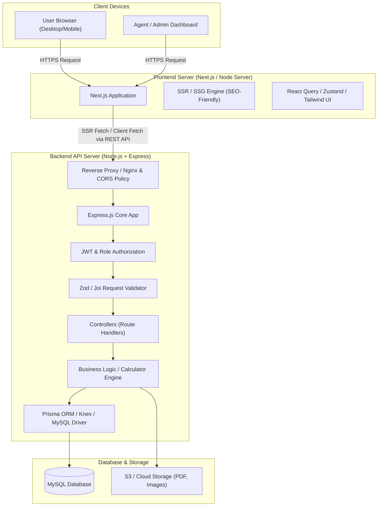
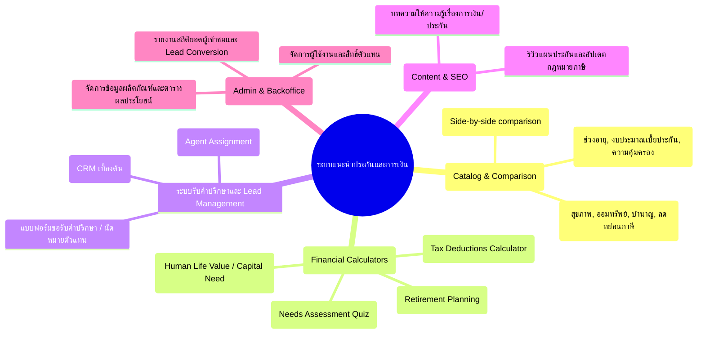
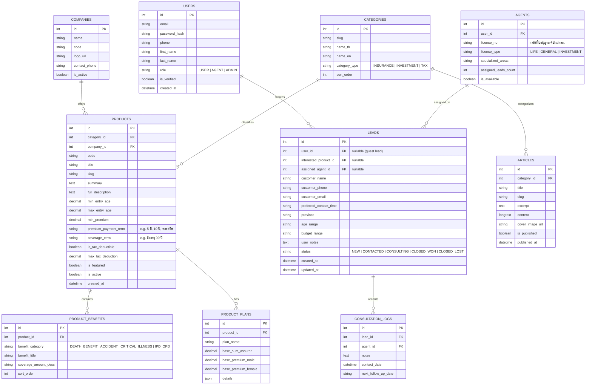
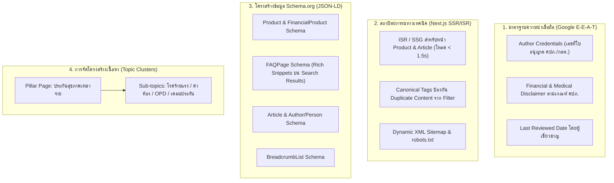
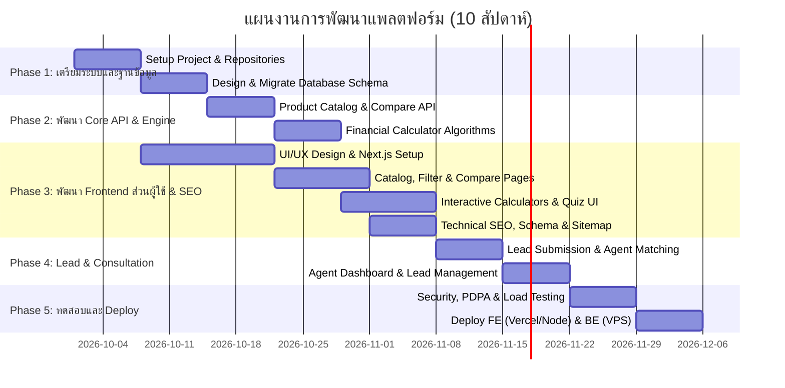

# แผนงานและการออกแบบระบบ: แพลตฟอร์มแนะนำประกันและผลิตภัณฑ์ทางการเงิน
(Financial & Insurance Advisory Platform)

---

## 1. ภาพรวมโครงการ (Project Overview)

โครงการนี้มีเป้าหมายเพื่อพัฒนาเว็บแพลตฟอร์มสำหรับ **แนะนำ เปรียบเทียบ และวางแผนการซื้อประกันและผลิตภัณฑ์ทางการเงิน** (เช่น ประกันชีวิต, ประกันสุขภาพ, ประกันสะสมทรัพย์/บำนาญ, กองทุนรวมลดหย่อนภาษี) โดยทำหน้าที่เป็นตัวกลางในการให้ความรู้ ประเมินความต้องการ (Needs Analysis) และเชื่อมโยงผู้ใช้เข้ากับที่ปรึกษาทางการเงินหรือตัวแทนมืออาชีพ

### เทคโนโลยีหลัก (Tech Stack)
- **Frontend (FE):** Next.js (React) + TailwindCSS + TypeScript
  - รันแยกเซิร์ฟเวอร์เฉพาะสำหรับ Frontend รองรับ Server-Side Rendering (SSR) และ Static Site Generation (SSG) เพื่อประสิทธิภาพ SEO สูงสุด
- **Backend API (BE):** Node.js + Express.js + TypeScript
  - รันแยกเซิร์ฟเวอร์ RESTful API พร้อมมาตรฐานสถาปัตยกรรมแบบ Controller-Service-Repository
- **Database:** MySQL (Relational Database)
  - จัดเก็บข้อมูลผลิตภัณฑ์, เงื่อนไขผลประโยชน์, ข้อมูล Lead, และสิทธิ์การใช้งาน
- **การเชื่อมต่อระหว่างเซิร์ฟเวอร์:** REST API (JSON) ผ่าน HTTPS + JWT Authentication + CORS Configuration

---

## 2. สถาปัตยกรรมระบบ (System Architecture)

ระบบออกแบบแยกเซิร์ฟเวอร์ (Decoupled Architecture) อย่างชัดเจนเพื่อความปลอดภัย ความยืดหยุ่นในการขยายสเกล (Scalability) และการบำรุงรักษา



### แนวทางการแยกเซิร์ฟเวอร์และการเชื่อมต่อ (Cross-Server Communication)
1. **Frontend Server (Next.js):**
   - รันบน Port เช่น `3000` (หรือชี้ Domain เช่น `www.yourdomain.com`)
   - ทำหน้าที่ Render UI, หน้าเว็บความรู้ (SEO), เครื่องคิดเลขคำนวณเบี้ยประกันเบื้องต้น
   - ดึงข้อมูลจาก API Server ผ่าน HTTP Client (Axios / Fetch)
2. **Backend Server (Express API):**
   - รันบน Port เช่น `5000` (หรือชี้ Subdomain เช่น `api.yourdomain.com`)
   - ให้บริการเฉพาะ JSON API
   - กำหนด **CORS (Cross-Origin Resource Sharing)** ให้ยอมรับ Request เฉพาะ Domain ของ Frontend เท่านั้น
   - ใช้ **Cookie (HttpOnly, Secure, SameSite=None/Strict)** หรือ **Bearer Token (JWT)** ในการยืนยันตัวตน
3. **Database Server (MySQL):**
   - รันแยกหรือผูกผ่าน Private Network กับ Backend Server ไม่อนุญาตให้เปิด Public IP ตรงๆ

---

## 3. ฟังก์ชันการทำงานหลัก (Core Features)



---

## 4. การออกแบบฐานข้อมูล (Database Schema)

### Entity Relationship Diagram (ERD)



---

## 5. การออกแบบ REST API Endpoints

ระบบ Backend จะให้บริการ API ผ่าน Base URL: `/api/v1`

### 5.1 หมวดหมู่และการค้นหาผลิตภัณฑ์ (Products & Categories)
| Method | Endpoint | สิทธิ์เข้าถึง | คำอธิบาย |
| :--- | :--- | :--- | :--- |
| `GET` | `/api/v1/categories` | Public | ดึงหมวดหมู่ทั้งหมด (เช่น ประกันสุขภาพ, มรดก, ลดหย่อนภาษี) |
| `GET` | `/api/v1/products` | Public | ค้นหาผลิตภัณฑ์ (Filter: category, age, budget, tax) |
| `GET` | `/api/v1/products/:slug` | Public | ดูรายละเอียดผลิตภัณฑ์และผลประโยชน์ของแผน |
| `POST` | `/api/v1/products/compare` | Public | ส่ง ID ผลิตภัณฑ์ 2-3 ตัวเพื่อดึงตารางเปรียบเทียบ |

### 5.2 เครื่องคำนวณและประเมิน (Calculators & Recommendation)
| Method | Endpoint | สิทธิ์เข้าถึง | คำอธิบาย |
| :--- | :--- | :--- | :--- |
| `POST` | `/api/v1/calculators/tax-deduction` | Public | คำนวณเพดานลดหย่อนภาษีและภาษีที่ประหยัดได้ |
| `POST` | `/api/v1/calculators/life-value` | Public | ประเมินความคุ้มครองชีวิตที่จำเป็น (Human Capital/Needs) |
| `POST` | `/api/v1/recommendations/quiz` | Public | วิเคราะห์ผลตอบแบบสอบถาม แนะนำ 3 แผนประกันที่เหมาะสม |

### 5.3 จัดการ Lead และการขอคำปรึกษา (Leads & Booking)
| Method | Endpoint | สิทธิ์เข้าถึง | คำอธิบาย |
| :--- | :--- | :--- | :--- |
| `POST` | `/api/v1/leads` | Public | ส่งแบบฟอร์มขอรับคำปรึกษา/นัดหมายตัวแทน |
| `GET` | `/api/v1/agent/leads` | Agent / Admin | ดึงรายการ Leads ที่ได้รับมอบหมาย |
| `PATCH`| `/api/v1/agent/leads/:id/status` | Agent / Admin | อัปเดตสถานะ Lead และบันทึกประวัติการติดต่อ |

### 5.4 จัดการระบบ (Admin Management)
| Method | Endpoint | สิทธิ์เข้าถึง | คำอธิบาย |
| :--- | :--- | :--- | :--- |
| `POST` | `/api/v1/admin/products` | Admin | เพิ่มข้อมูลผลิตภัณฑ์ใหม่ |
| `PUT`  | `/api/v1/admin/products/:id` | Admin | แก้ไขข้อมูลผลิตภัณฑ์ |
| `DELETE`| `/api/v1/admin/products/:id`| Admin | ซ่อน/ลบผลิตภัณฑ์ |
| `GET`  | `/api/v1/admin/dashboard` | Admin | สถิติภาพรวม (จำนวน Leads, Conversion rate) |

---

## 6. โครงสร้างโฟลเดอร์โปรเจกต์ (Project Directory Structure)

แนะนำให้แยก Repositories หรือทำเป็น Monorepo โดยแบ่งเป็น `frontend/` และ `backend/`:

```
financial-advisory-platform/
├── backend/                        # Node.js + Express Server
│   ├── src/
│   │   ├── config/                 # Database, JWT, Environment variables
│   │   │   ├── db.ts
│   │   │   └── env.ts
│   │   ├── constants/              # Enums, Error codes
│   │   ├── controllers/            # Request handlers
│   │   │   ├── auth.controller.ts
│   │   │   ├── product.controller.ts
│   │   │   ├── lead.controller.ts
│   │   │   └── calculator.controller.ts
│   │   ├── middlewares/            # Auth, validation, error handler, rate limit
│   │   │   ├── auth.middleware.ts
│   │   │   ├── validate.middleware.ts
│   │   │   └── errorHandler.ts
│   │   ├── models/                 # Database Models / Prisma Schema / SQL Queries
│   │   │   └── product.model.ts
│   │   ├── routes/                 # Express Routers
│   │   │   ├── v1/
│   │   │   │   ├── auth.routes.ts
│   │   │   │   ├── product.routes.ts
│   │   │   │   ├── lead.routes.ts
│   │   │   │   └── index.ts
│   │   ├── services/               # Business Logic & Algorithms
│   │   │   ├── product.service.ts
│   │   │   ├── lead.service.ts
│   │   │   └── taxCalculator.service.ts
│   │   ├── utils/                  # Helper functions (logger, tokens)
│   │   └── app.ts                  # Express application configuration
│   ├── server.ts                   # Entry point (Listen port)
│   ├── .env.example
│   ├── tsconfig.json
│   └── package.json
│
└── frontend/                       # Next.js (React) Application (Port 3000)
    ├── src/
    │   ├── app/                    # Next.js App Router
    │   │   ├── sitemap.ts          # Dynamic XML Sitemap (ดึง URLs จาก BE API)
    │   │   ├── robots.ts           # Dynamic robots.txt
    │   │   ├── (public)/           # กลุ่มหน้าที่เข้าถึงได้ทั่วไป (SEO-Friendly)
    │   │   │   ├── page.tsx        # หน้าแรก (Homepage & Hero)
    │   │   │   ├── products/
    │   │   │   │   ├── page.tsx    # รายการผลิตภัณฑ์ & ตัวกรอง
    │   │   │   │   ├── [slug]/     # หน้ารายละเอียดแผนประกัน (SSG/ISR + Schema.org)
    │   │   │   │   └── compare/    # หน้าเปรียบเทียบ 2-3 แผน
    │   │   │   ├── calculators/
    │   │   │   │   ├── tax/        # หน้าคำนวณภาษี (Target Keyword: คำนวณภาษี 2567)
    │   │   │   │   └── life-value/ # หน้าคำนวณทุนประกัน
    │   │   │   ├── quiz/           # แบบสอบถามค้นหาแผนที่ใช่
    │   │   │   └── articles/       # บล็อกความรู้การเงิน (Target: Long-tail Keywords)
    │   │   │       ├── page.tsx
    │   │   │       └── [slug]/page.tsx
    │   │   ├── (portal)/           # ระบบ Agent / Admin Dashboard (Disallow in robots.txt)
    │   │   │   ├── dashboard/
    │   │   │   └── leads/
    │   │   └── layout.tsx          # Root Layout + Global JSON-LD Organization
    │   ├── components/             # Reusable UI Components
    │   │   ├── common/             # Button, Input, Modal, Card
    │   │   ├── products/           # ProductCard, FilterSidebar, CompareTable
    │   │   ├── calculators/        # Slider, ResultChart, Breakdown
    │   │   ├── seo/                # JsonLd.tsx, BreadcrumbSchema.tsx, FAQSchema.tsx
    │   │   └── layout/             # Navbar, Footer (Internal Links)
    │   ├── hooks/                  # Custom React Hooks
    │   ├── lib/                    # Axios instance, API client helpers
    │   │   └── api-client.ts
    │   ├── store/                  # Client state (Zustand)
    │   ├── types/                  # TypeScript interfaces
    │   └── styles/                 # Tailwind / CSS styles
    ├── public/                     # Static assets (icons, illustrations)
    ├── .env.local.example
    ├── next.config.ts
    ├── tailwind.config.ts
    └── package.json
```

---

## 7. กลยุทธ์และสถาปัตยกรรม SEO สำหรับธุรกิจประกันและการเงิน (SEO Architecture & E-E-A-T)

ธุรกิจประกันและการเงินถูกจัดเป็นกลุ่ม **YMYL (Your Money Your Life)** ตามเกณฑ์ของ Google Search Quality Rater ซึ่ง Google มีอัลกอริทึมตรวจสอบความถูกต้องและน่าเชื่อถือที่เข้มงวดที่สุด การทำ SEO จึงไม่ใช่แค่ใส่คีย์เวิร์ด แต่ต้องวางโครงสร้างทางเทคนิคและเนื้อหาอย่างเป็นระบบ:



### 7.1 เทคนิคการ Render บน Next.js เพื่อคะแนน Core Web Vitals
- **Incremental Static Regeneration (ISR):**
  - หน้ารายละเอียดแผนประกัน (`/products/[slug]`) และบทความ (`/articles/[slug]`) จะถูกสร้างเป็น Static HTML ล่วงหน้า (`generateStaticParams`)
  - กำหนด `revalidate: 3600` (อัปเดตแคชทุก 1 ชั่วโมงเมื่อมีการแก้ไขข้อมูล) ทำให้ Googlebot เข้าถึงเนื้อหาได้ทันทีในเวลาเสี้ยววินาทีโดยไม่ต้องรอคิวรัน Database
- **Dynamic Metadata & Social Graph:**
  - ใช้ฟังก์ชัน `generateMetadata()` ของ Next.js เพื่อดึง Title, Meta Description, Canonical URL, OpenGraph Image (OG Tag) และ Twitter Card แบบไดนามิกตามแต่ละผลิตภัณฑ์
- **Core Web Vitals Optimization:**
  - ใช้ `next/image` สำหรับรูปภาพโลโก้และอินโฟกราฟิก (แปลงเป็น WebP อัตโนมัติ + Responsive sizes + ป้องกัน Layout Shift - CLS)
  - ใช้ `next/font` ลดเวลาโหลดฟอนต์ภาษาไทย (เช่น Sarabun / Prompt) แบบ Zero Layout Shift

### 7.2 โครงสร้าง Rich Snippets ด้วย Schema.org (JSON-LD)
ระบบจะฝัง Script `application/ld+json` ในส่วน `<head>` ของแต่ละหน้า:
1. **FinancialProduct / Product Schema (หน้าแผนประกัน):**
   - ระบุชื่อแผน, บริษัทประกัน (`brand`), ช่วงราคาเบี้ยประกัน (`offers`), เงื่อนไขความคุ้มครอง
2. **FAQPage Schema (หน้าเปรียบเทียบและบทความ):**
   - ฝังคำถาม-คำตอบยอดฮิต เช่น *"ประกันสุขภาพเหมาจ่าย เคลมได้สูงสุดกี่บาท?"*, *"เบี้ยประกันลดหย่อนภาษีได้เท่าไหร่?"* เพื่อให้ Google แสดงผลเป็นคำถามพับได้ในหน้าผลการค้นหา เพิ่ม CTR (Click-Through Rate) สูงขึ้น 20-30%
3. **Person & Organization Schema (ผู้เขียนและที่ปรึกษา):**
   - ยืนยันตัวตนของผู้เขียนบทความ เช่น นายหน้า/ตัวแทนประกันชีวิตที่มีเลขทะเบียนใบอนุญาต คปภ. ชัดเจน
4. **BreadcrumbList Schema:**
   - ช่วยให้ Google เข้าใจลำดับโครงสร้าง URL เช่น `หน้าแรก > ประกันชีวิต > ประกันลดหย่อนภาษี > แผน A`

### 7.3 การจัดการ Duplicate Content จาก Search Filters & Calculators
- ในหน้าค้นหาที่มี Filter ซับซ้อน เช่น `/products?category=health&age=30&gender=M&budget=20000`
- จะต้องกำหนด `<link rel="canonical" href="https://yourdomain.com/products/health" />` เพื่อบอก Google ว่าหน้าหลักคือหน้าหมวดหมู่ ป้องกันไม่ให้ Google มองว่ามีหน้าซ้ำซ้อน (Duplicate Pages)
- หน้าเครื่องมือคำนวณภาษี (`/calculators/tax`) จะสร้างเป็น **Static Landing Page** ที่เน้นเจาะคีย์เวิร์ด เช่น *"คำนวณภาษี 2567"*, *"วางแผนลดหย่อนภาษีด้วยประกัน"* พร้อมเนื้อหาอธิบายขั้นตอนและสูตรคำนวณ

### 7.4 โครงสร้าง URL และกลยุทธ์ Keyword (Topic Cluster)
- ออกแบบ URL สั้น อ่านง่าย และมีคีย์เวิร์ด (Clean Slugs):
  - หมวดหมู่: `/insurance/health` (ประกันสุขภาพ), `/insurance/savings` (ประกันสะสมทรัพย์)
  - ผลิตภัณฑ์: `/insurance/health/super-care-เหมาจ่าย`
  - บทความ: `/articles/how-to-choose-health-insurance-2026`
- **Topic Cluster (Hub & Spoke Model):**
  - หน้า Hub (Pillar): หน้ารวมประกันสุขภาพ อธิบายภาพรวม
  - หน้า Spoke: บทความเจาะลึกเฉพาะทาง เช่น *ประกันสุขภาพเด็ก*, *ประกันโรคร้ายแรง*, *ประกันสุขภาพเหมาจ่าย vs แยกจ่าย*
  - ลิงก์ภายใน (Internal Linking) เชื่อมโยงกลับหากันและส่งต่อไปยังหน้าขอรับคำปรึกษา (CTA to Lead Form)

---

## 8. ความปลอดภัยและการปฏิบัติตามกฎหมาย (Security & PDPA Compliance)

ธุรกิจประกันและการเงินเกี่ยวข้องกับข้อมูลส่วนบุคคลที่มีความอ่อนไหวสูง (Sensitive Personal Data):

1. **การยินยอมเก็บข้อมูล (PDPA Consent):**
   - ทุกฟอร์มขอรับคำปรึกษาต้องมี Checkbox ข้อตกลงให้ความยินยอมเปิดเผยข้อมูลแก่ตัวแทน
   - บันทึก Consent Log (วัน เวลา และเวอร์ชันของข้อตกลงที่กดยอมรับ)
2. **การป้องกันข้อมูลส่งผ่านเครือข่าย:**
   - บังคับใช้ **HTTPS (TLS 1.3)** ทั้ง Frontend และ Backend
   - ใช้ **CORS Whitelist** กำหนดเฉพาะ Domain ของ Frontend
3. **การป้องกันการโจมตีทางเว็บ:**
   - **Rate Limiting:** จำกัดจำนวนการส่งแบบฟอร์ม Lead (เช่น ป้องกัน Bot ยิง Spam ด้วย Express-rate-limit และ Cloudflare Turnstile / reCAPTCHA)
   - **Data Validation:** ตรวจสอบความถูกต้องของ Input ด้วย Zod/Joi ก่อนเข้า Database ป้องกัน SQL Injection
   - **Helmet.js:** เสริมความปลอดภัย HTTP Headers

---

## 9. แผนการดำเนินงานเป็นระยะ (Implementation Roadmap)



### สรุป Milestones:
- **สัปดาห์ที่ 1 - 2:** Setup Environment (Next.js, Express, MySQL) + ออกแบบตาราง Database และ Seed ข้อมูลตัวอย่าง
- **สัปดาห์ที่ 3 - 4:** พัฒนา REST API ฝั่ง Backend (ค้นหา, คัดกรอง, สูตรคำนวณเบี้ยและลดหย่อนภาษี)
- **สัปดาห์ที่ 5 - 6:** พัฒนา Frontend หน้าแรก, หน้าแคตตาล็อก, ตัวกรอง, ตารางเปรียบเทียบ 3 แผน, และเครื่องคิดเลข
- **สัปดาห์ที่ 7 - 8:** ติดตั้งระบบ Technical SEO (JSON-LD, Dynamic Sitemap, ISR, Canonical tags) และระบบฟอร์ม Lead สำหรับตัวแทน
- **สัปดาห์ที่ 9 - 10:** ทำระบบความปลอดภัย, ติดตั้ง Turnstile ป้องกัน Spam, ตรวจสอบเกณฑ์ PDPA และ E-E-A-T, แล้ว Deploy ขึ้น Production แยกเซิร์ฟเวอร์
